# Corpus shot list — fill in the blanks

19 of the 122 images need something before they can carry a label that scores.
**Type your answers into the `>` lines and hand this file back.** Anything you
leave blank stays as it is.

Images render inline in a Markdown preview (VS Code: `Cmd+Shift+V`).

| what's needed | how many |
|---|---|
| ISBN, no reshoot | 10 |
| Title **and** ISBN — need a second photo | 2 |
| A decision only you can make | 4 |
| Worth reshooting | 2 |
| Privacy check | 1 |

⛔ **Why I won't fill the ISBNs in myself:** a photograph is of one physical copy,
so its ISBN belongs to that edition — and most of these works have many. This
corpus already records what guessing costs: the plan once cited Bird Lake Moon's
ISBN for a fixture that is actually The Name of the Rose, and the note in
`vision_corpus.exs` says *"the model was right where this label was wrong."*

---

## 1. Need the ISBN — 10 photos, no reshoot

I can read the title on each of these but not the barcode, so each is filed under
its title alone. That scores the *work* but not the *edition*. The number from the
copyright page or the barcode is all that's missing.

### 1.1 The Last Days of New Paris

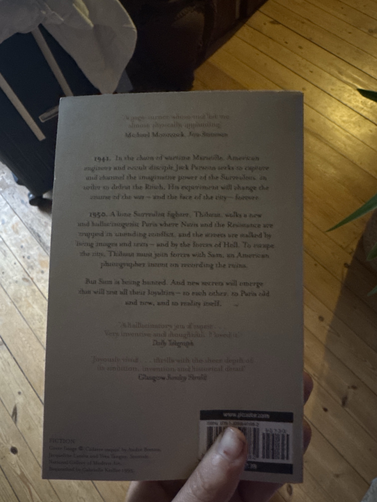

- **File:** `hostile-the-last-days-of-new-paris.jpg`
- **I read:** China Miéville, Picador. Thumb covers the right half: `978-1-…84198-2`

> **ISBN-13:**
> **Correct title?** (blank = The Last Days of New Paris)

### 1.2 Heart of Darkness

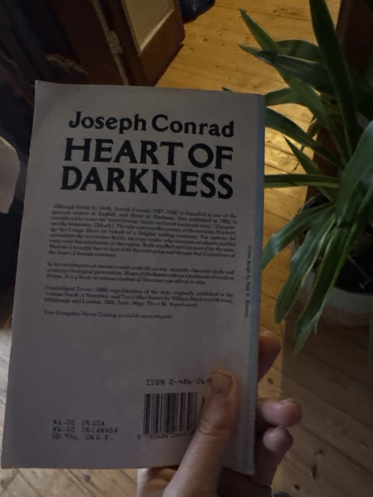

- **File:** `hostile-heart-of-darkness.jpg`
- **I read:** Joseph Conrad, Dover Thrift. Starts `ISBN 0-486-26…` then your thumb.
  Dover has many printings, so the rest can't be inferred.

> **ISBN-13:**
> **Correct title?**

### 1.3 The Children of Mer

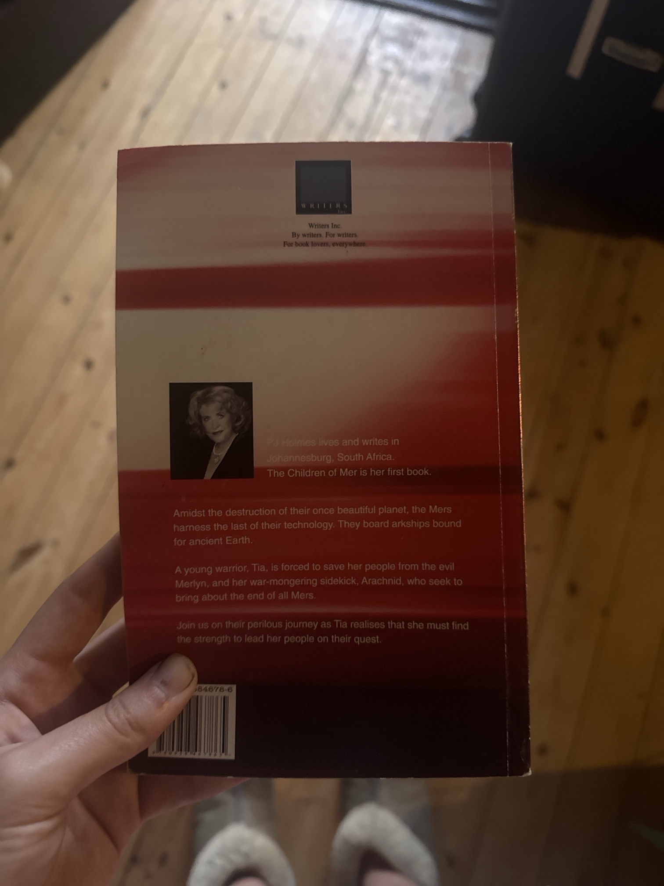

- **File:** `hostile-the-children-of-mer.jpg`
- **I read:** PJ Holmes, Writers Inc. Ends `…84678-6`. Self-published SA title, so
  I can't infer the prefix.

> **ISBN-13:**
> **Correct title?**

### 1.4 The Dichotomy of Leadership

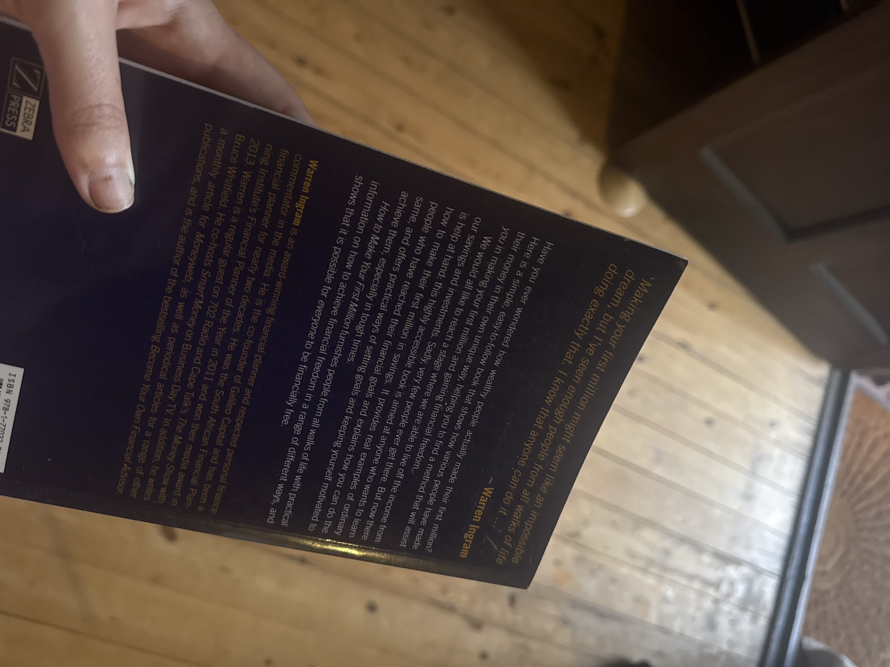

- **File:** `hostile-the-dichotomy-of-leadership.jpg`
- **I read:** Willink & Babin, Macmillan. `978-1-??0-10648-2` — two digits under
  your thumb, and this has UK and US editions.

> **ISBN-13:**
> **Correct title?**

### 1.5 How to Make Your First Million

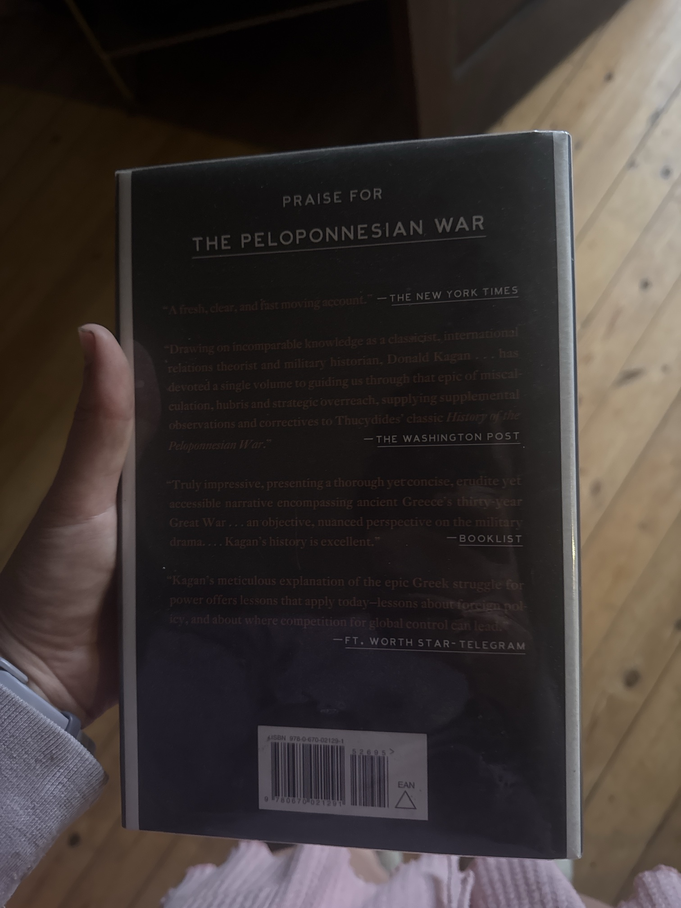

- **File:** `hostile-how-to-make-your-first-million.jpg`
- **I read:** Warren Ingram, Zebra Press. Frame rotated 90°, number runs off the
  edge: `978-1-77022-…`

> **ISBN-13:**
> **Correct title?**

### 1.6 Moon-Whales

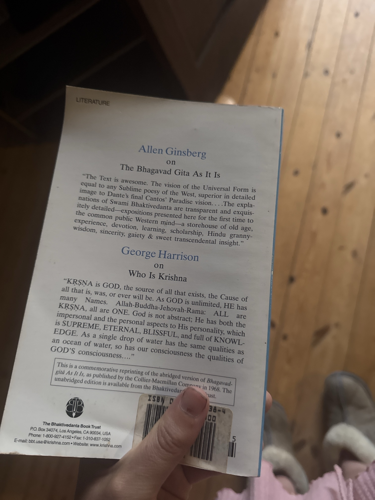

- **File:** `hostile-moon-whales.jpg`
- **I read:** Ted Hughes, Faber, illustrated by Chris Riddell. `ISBN 0-571-16320-?`
  — check digit under your thumb, barcode too.

> **ISBN-13:**
> **Correct title?**

### 1.7 The Collected Poems of Emily Dickinson

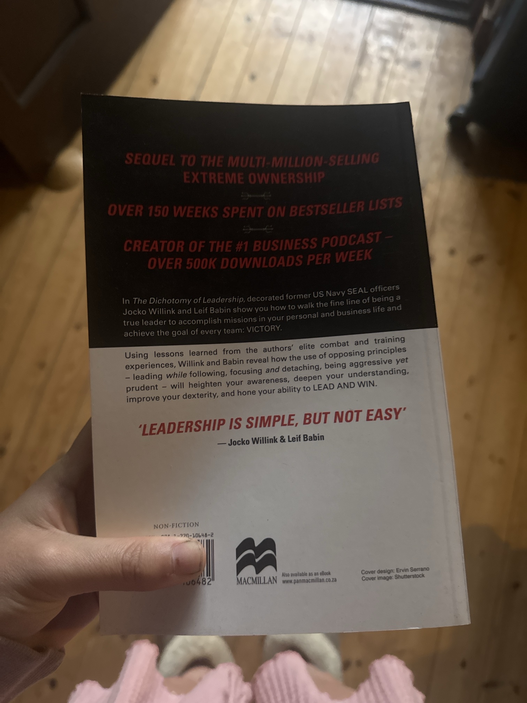

- **File:** `hostile-the-collected-poems-of-emily-dickinson.jpg`
- **I read:** Barnes & Noble Classics, introduction by Rachel Wetzsteon. Rotated,
  both the 13 and the 10 cut off: `978-1-59…`

> **ISBN-13:**
> **Correct title?**

### 1.8 Bhagavad Gita As It Is

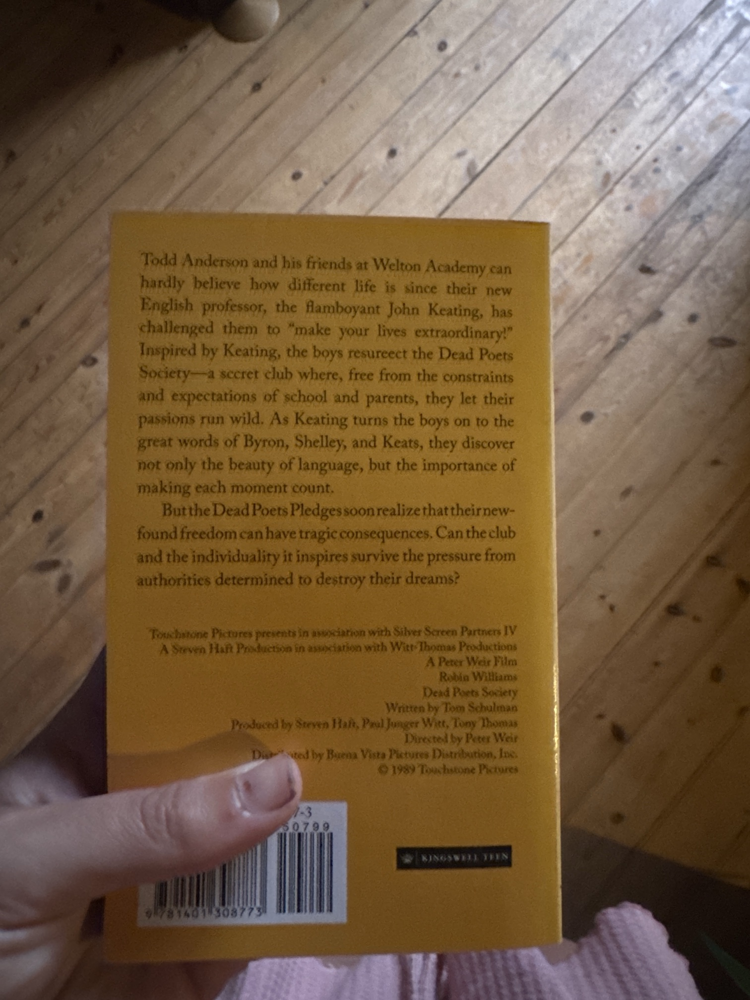

- **File:** `hostile-bhagavad-gita-as-it-is.jpg`
- **I read:** Bhaktivedanta Book Trust, the abridged 1968 commemorative reprint.
  Thumb sits squarely on the barcode.

> **ISBN-13:**
> **Correct title?**

### 1.9 Star Wars: A Scanimation Book

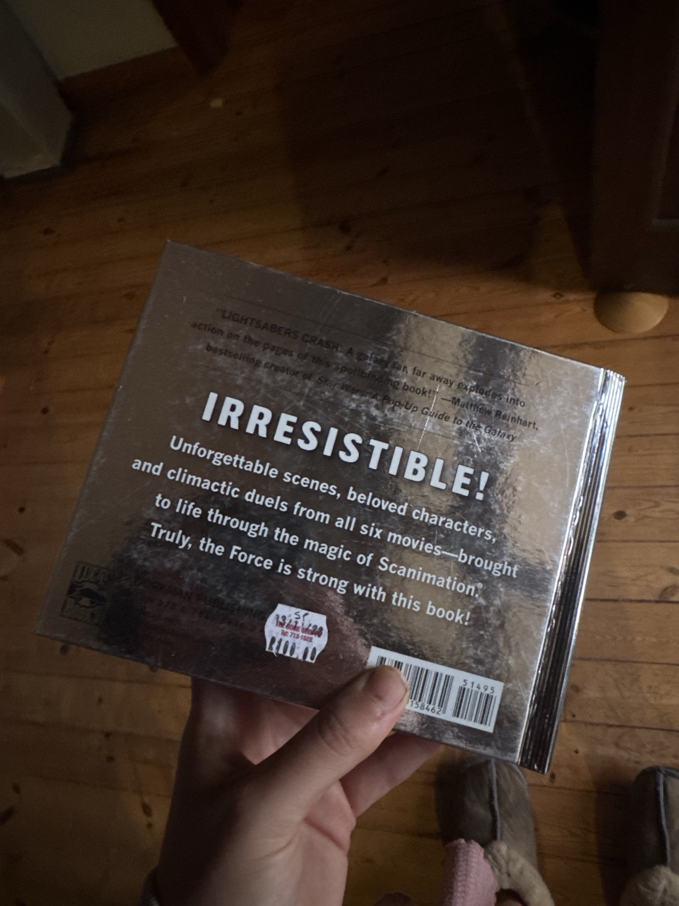

- **File:** `hostile-star-wars-a-scanimation-book.jpg`
- **I read:** Workman. A shop price sticker covers the left of the barcode and
  glare does the rest. I see `…158462` and `51495`.

> **ISBN-13:**
> **Correct title?**

### 1.10 Families Belong

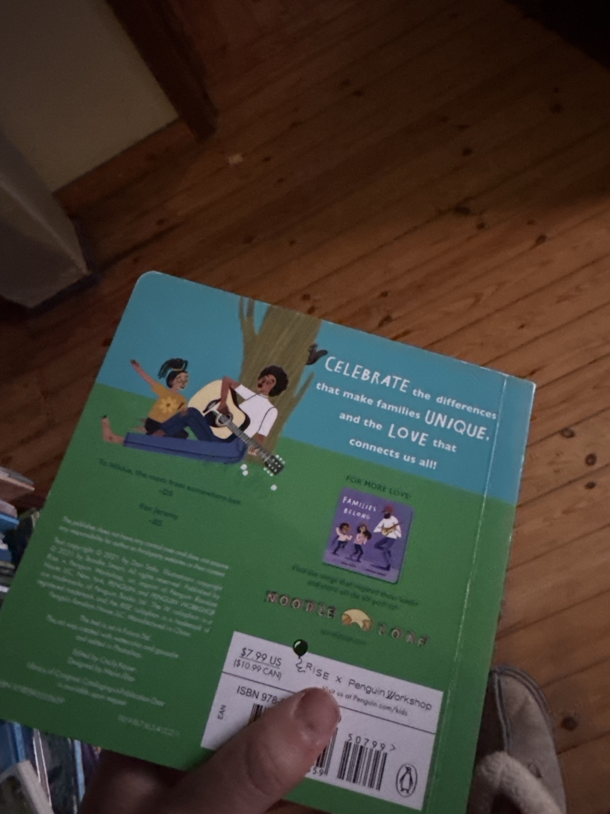

- **File:** `hostile-families-belong.jpg`
- **I read:** Dan Saks, Rise × Penguin Workshop. ⚠️ The title comes from the
  *inset thumbnail* on the back, not from the cover itself — worth confirming.
  `ISBN 978-0-…` then thumb.

> **ISBN-13:**
> **Correct title?**

---

## 2. Can't identify at all — 2 photos, need a second shot

Both are perfectly good hostile-barcode images, but neither the barcode nor a
title is legible, so I have nothing to score them against. **One extra photo of
the front cover fixes each** — the originals stay in the corpus unchanged.

### 2.1 Grey hardcover, two circular emblems

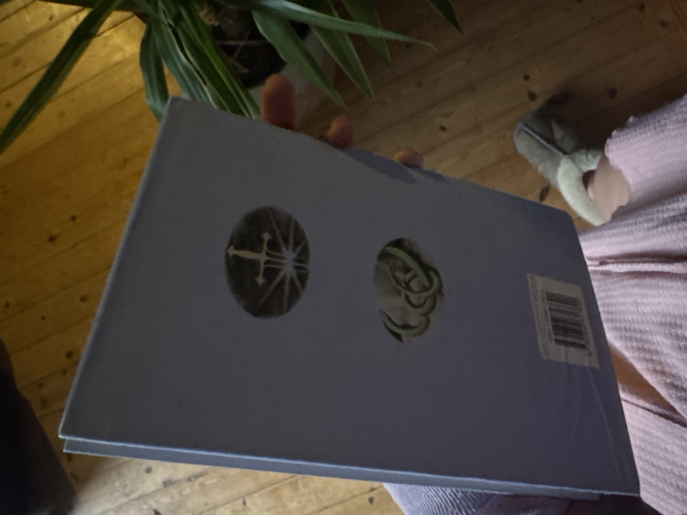

- **File:** `hostile-grey-hardcover-emblems.jpg`
- **What I see:** a sword-and-starburst motif and what may be a serpent or dragon,
  on plain grey board. Barcode top-right, small and foreshortened. No title in frame.

> **Title:**
> **Author:**
> **ISBN-13:**
> **Front cover photo attached?** (yes / no)

### 2.2 Blue picture book — Sara and the aviary

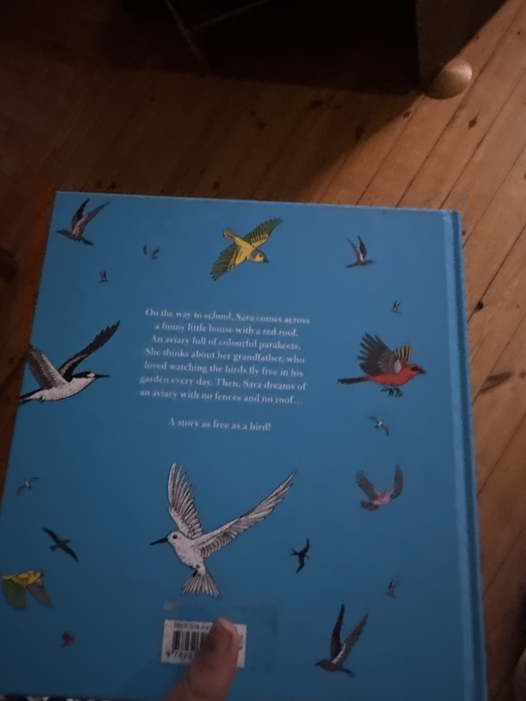

- **File:** `hostile-blue-bird-picture-book.jpg`
- **What I see:** the blurb describes Sara finding a house with a red roof and an
  aviary of parakeets, and remembering her grandfather. No title on the back;
  thumb over the barcode.
- ⚠️ **This is the weakest-labelled image in the corpus.** It currently carries
  only a description, so it can't score an identification either way.

> **Title:**
> **Author / illustrator:**
> **ISBN-13:**
> **Front cover photo attached?** (yes / no)

---

## 3. Need your call — 4 photos, no reshoot

Each is a good photo filed under a stratum I'm unsure about, or carrying ground
truth the schema can't fully express. These are judgements about what "correct"
means, which is yours.

### 3.1 Four titles, two languages

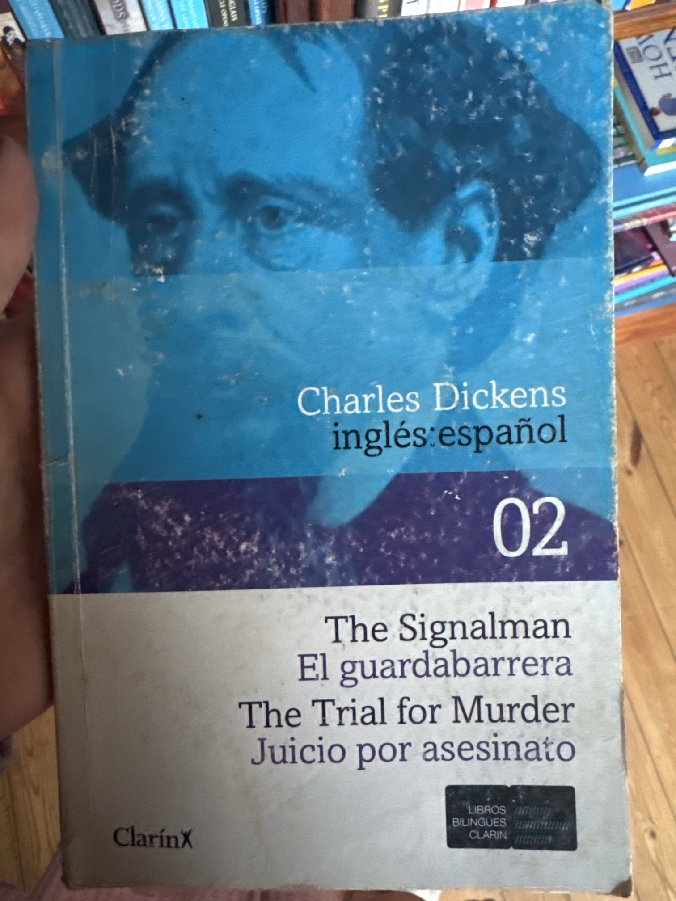

- **File:** `cover-the-signalman.jpg`
- **The problem:** the cover carries *The Signalman*, *El guardabarrera*,
  *The Trial for Murder* and *Juicio por asesinato*. I labelled it `the signalman`.
  A system returning "El guardabarrera" would score **wrong while being right**.

> **Ground truth should be:** (first English title / both English titles / move to
> hostile-typography where a confusing cover is the point / other)

### 3.2 Two books, one expectation field

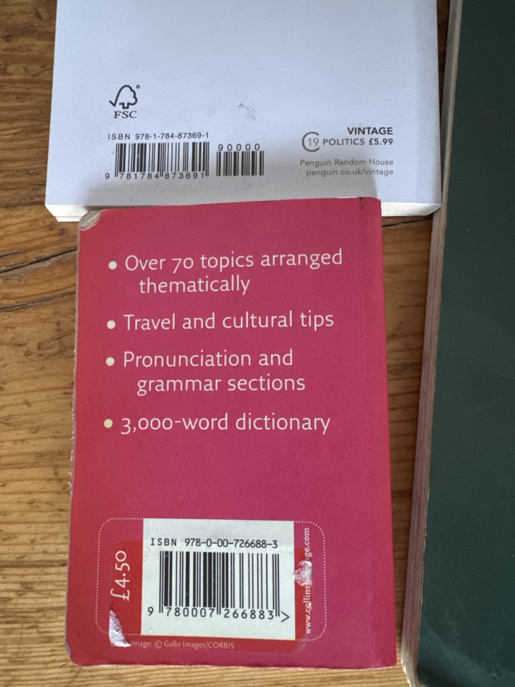

- **File:** `multi-9781784873691-9780007266883.jpg`
- **The problem:** both ISBNs are in the filename and both are check-digit valid,
  but `expect_isbn` holds a single value. The harness will score only the
  Communist Manifesto and ignore the phrasebook entirely.

> **Primary book should be:** (Communist Manifesto / Collins phrasebook)
> **Make the field list-valued?** (yes = I add it to the harness / no = single slot is fine)

### 3.3 Bookshelf filed as adjacent, but the spines are readable

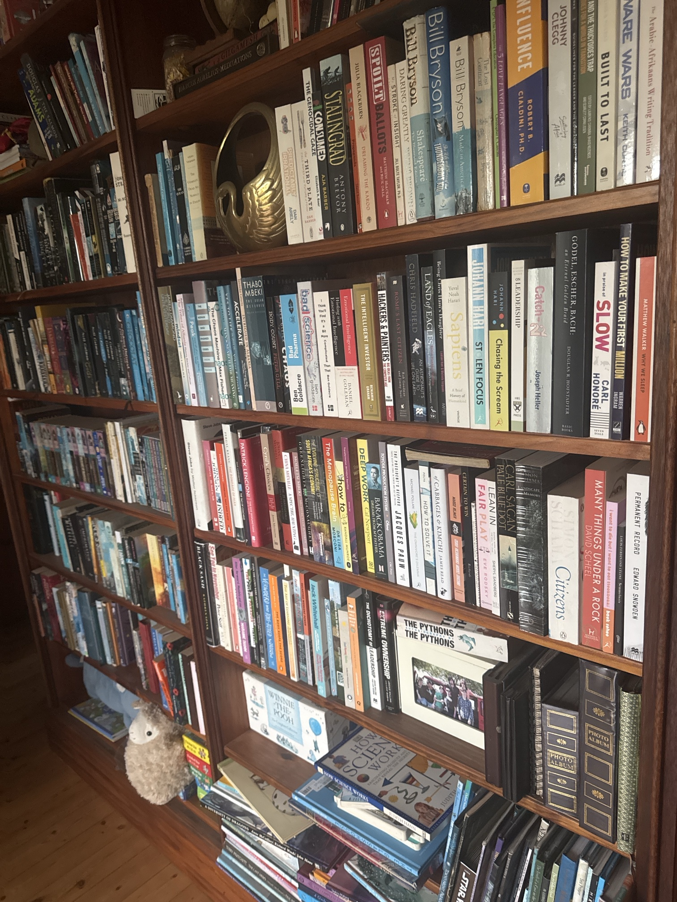

- **File:** `adjacent-bookshelf-close.jpg`
- **The problem:** the plan puts "a bookshelf photographed at distance" in the
  adjacent stratum — meaning too far to identify, so the system should decline.
  Here I can read Bill Bryson, Sapiens, Gödel Escher Bach and a dozen more. That's
  a multi-book frame, where it *should* identify.

> **Move to `multi-`?** (yes / no)
> **If yes, 2–3 ISBNs from the shelf:**

### 3.4 A box that contains books

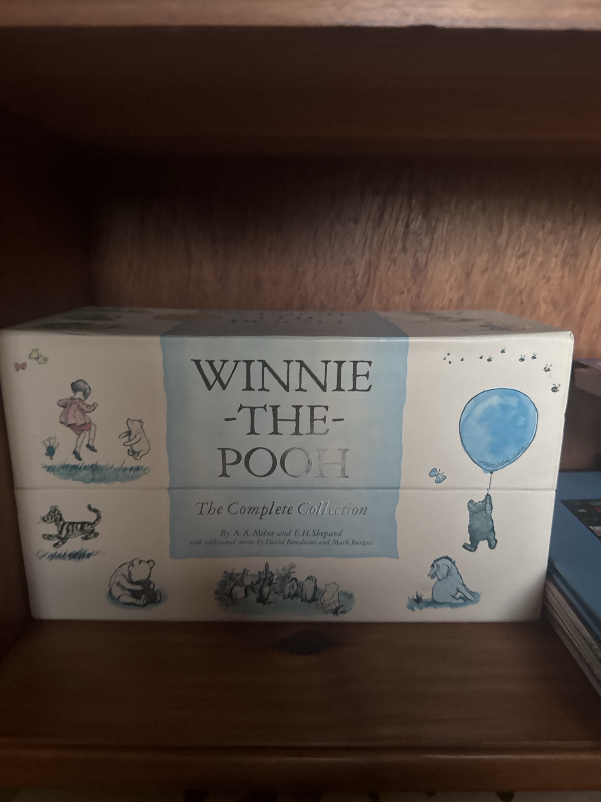

- **File:** `adjacent-winnie-the-pooh-slipcase.jpg`
- **The problem:** a slipcase is packaging, not a book — which argues for adjacent.
  But it carries a title, an author and an illustrator, and the thing inside is
  unambiguously books. A reader photographing this expects it to work.

> **Should it identify or decline?** (identify = needs the set's ISBN below /
> decline = stays as a false-accept test)
> **ISBN-13 if it should identify:**

---

## 4. Worth reshooting — 2 photos

Both are fine images that landed in the wrong stratum because of how they were
taken. A different angle puts each where it belongs.

### 4.1 Rotated 90° in a face-on stratum

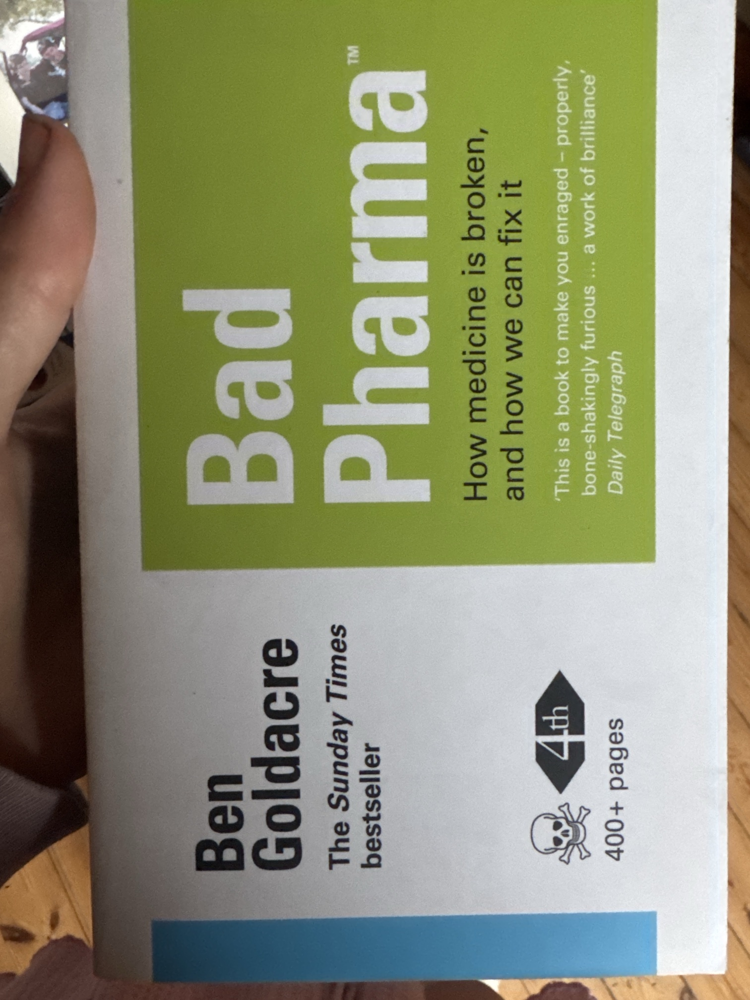

- **File:** `cover-bad-pharma.jpg`
- **Why it's insufficient:** the stratum is "cover, no barcode, **clear** title and
  author". The title is legible but runs vertically, which makes this a *rotation*
  test sitting in a stratum that isn't testing rotation. It quietly makes the
  stratum look harder than it is.
- **What to retake:** face-on, portrait, title horizontal, no barcode in frame.
- ⬛ Keep the existing frame too if you like — I'll move it to the
  mirrored/rotated stratum, where it's genuinely useful.

> **Replacement photo attached?** (yes / no)
> **Keep the rotated one as a rotation test?** (yes / no)

### 4.2 Other books in frame

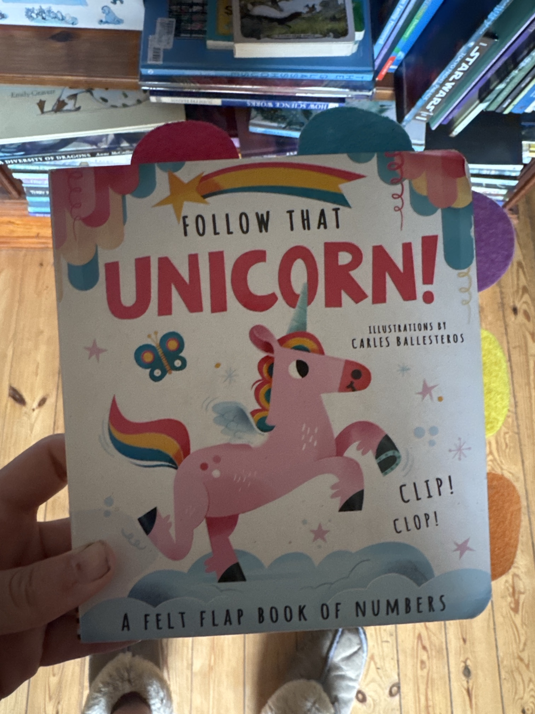

- **File:** `cover-follow-that-unicorn.jpg`
- **Why it's insufficient:** a felt flap board book with heavy decorative type —
  the best hostile-typography candidate you've sent. But two or three other books
  sit behind it, making it ambiguous between a single-cover test and a multi-book
  frame.
- **What to retake:** the book alone, on a plain surface, so the typography is the
  only difficulty.
- ⬛ Then it moves to the typography stratum — the one gap that actually decides
  the architecture question.

> **Replacement photo attached?** (yes / no)

---

## 5. Privacy check — 1 photo, your eyes not mine

### 5.1 Framed pictures behind the cake

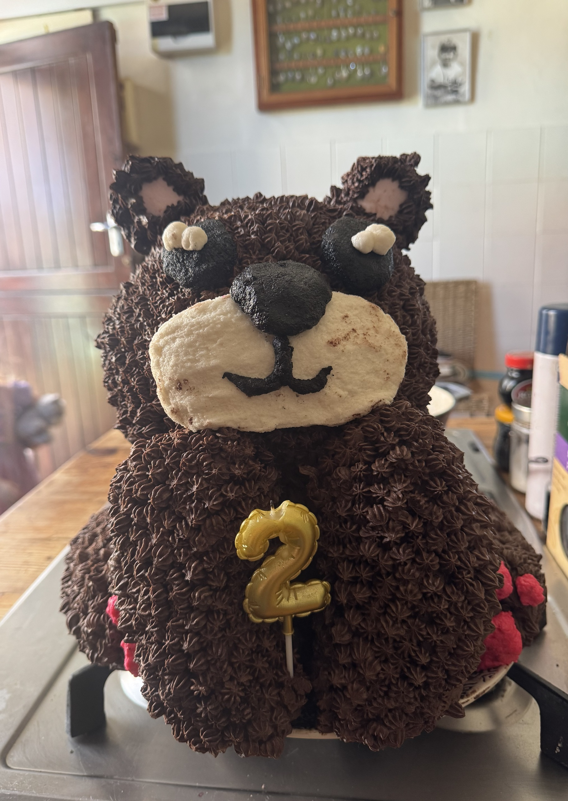

- **File:** `neg-bear-birthday-cake.jpg`
- **What I noticed:** two framed items above the cake — one looks like a team or
  group photo, the other may be a portrait. Small and indistinct at this
  resolution, and it's your kitchen, so entirely your call. Raising it only
  because this corpus is permanent and gets copied into PRs and bug reports.
- Cropping loses nothing: the cake is the whole point of the negative.

> **Keep as-is, or crop the top third?** (keep / crop)

---

## For reference — two that worked

Both have something physically covering the barcode, and the ISBN was still
readable and check-digit verified. This is what a hostile image looks like when it
stays scoreable.

| | |
|---|---|
| 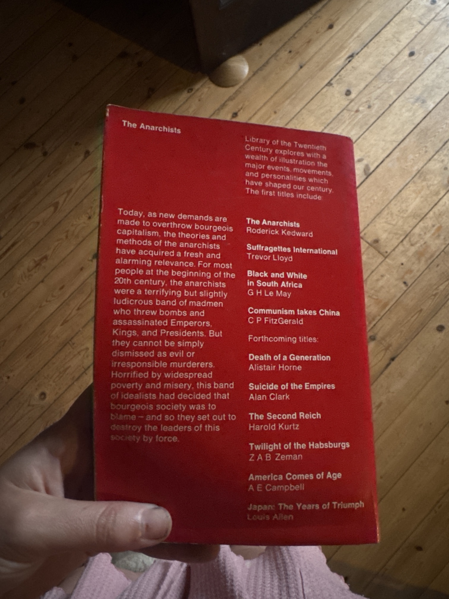 | **Dead Poets Society** — thumb over the left edge, enough digits remain to reconstruct and verify `9781401308773` |
| 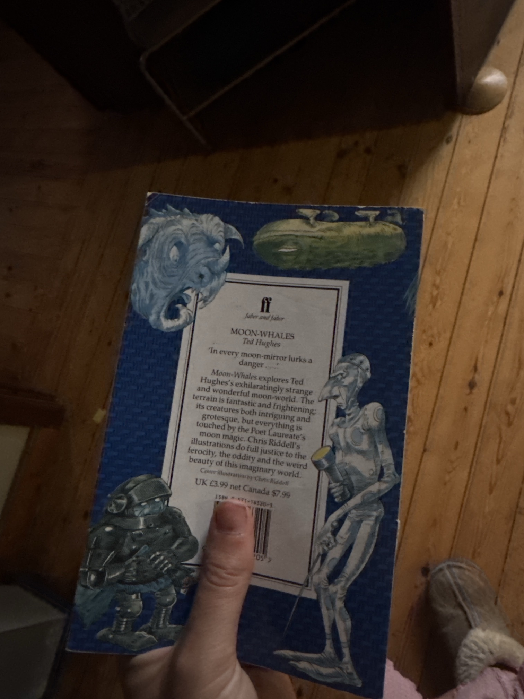 | **Made in America** — a shop price sticker across the barcode, printed ISBN survives beside it: `9780552998055` |

---

## Where the corpus stands

| Stratum | | Target |
|---|---|---:|
| Barcode hostile | complete | 20 / 20 |
| Mirrored & rotated *(generated)* | complete | 10 / 10 |
| Deliberately illegible *(generated)* | complete | 10 / 10 |
| Cover, no barcode | 3 short | 22 / 25 |
| Clean barcode | 2 short | 18 / 20 |
| Not a book | 3 short | 17 / 20 |
| Book-adjacent | 3 short | 12 / 15 |
| **Hostile typography** | **16 short** | 4 / 20 |
| **Multiple books in frame** | **14 short** | 1 / 15 |

**122 images** — 94 you shot, 20 generated from your clean originals, 8
pre-existing. That's 79% of the plan's 155, and every identity-bearing image
carries an identity.

The two real gaps are **typography** and **multi-book frames**:

- **Multi-book is five minutes.** Point your phone at any shelf and note the ISBNs
  of two or three books in the frame.
- **Typography decides the architecture question.** Art titles, foreign scripts,
  series names that dominate the book's own, embossed or foil titles catching the
  light, covers where the title is part of the artwork.
